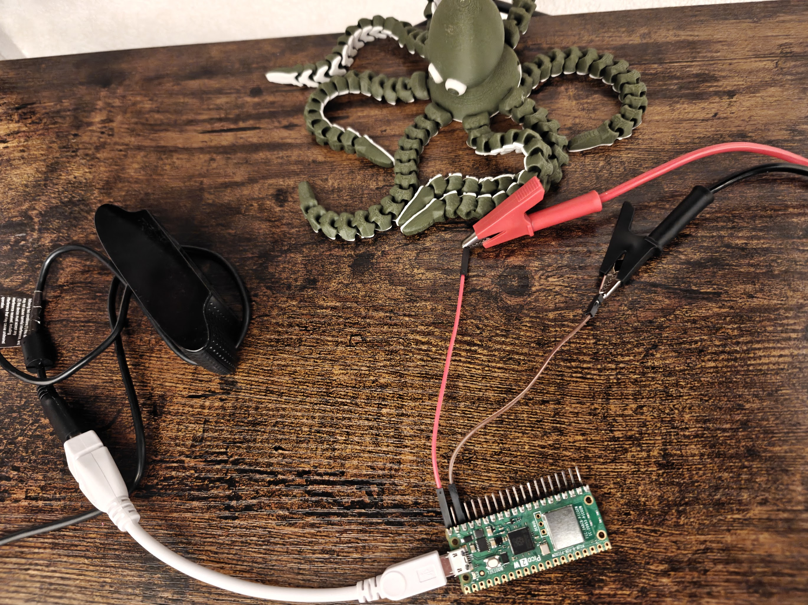
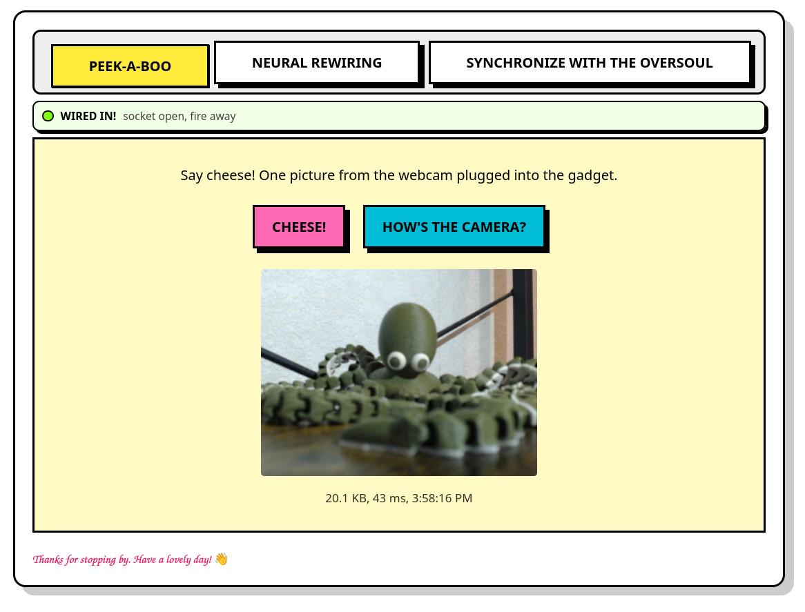

# Pico WebCam

Proof of concept - webcam connected to a raspberry pi pico streaming to a HTTP client
More info in 'os' submodule how things work and are hooked.

# How to use

Check releases for uf2 file, flash it to pico \
It will start in setup mode `picow_config` / `randompassword` ( http://192.168.4.1 ) \
Configure wifi and press reboot button or just access the webcam there \
If wifi configure then find its ip address over LAN

# How to build and technical info

Just check out 'os' for the firmware, explains everything or check out other repos for more info

Some pictures below

